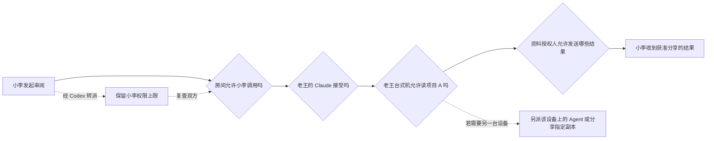

# 会议室联系人权限与多设备协作

## 权限归属

房间成员分为用户和 Agent。单机房间继续使用本机屋主身份，外部用户和成员连接端各用独立的可撤销凭证。配对设备代表屋主的一个操作入口。Agent 实例应按所属用户和执行设备区分，即使两台设备装的是同一款 Agent。

| 授权位置 | 谁设置 | 范围 |
| --- | --- | --- |
| 房间成员 | 房间管理员 | 入房、历史可见范围、发言、可调用的 Agent、可派发的操作 |
| Agent 共享 | Agent 所有人 | 在本房接受哪些成员、接受哪些任务、能否接收或发起转派 |
| 设备工作区 | 工作区管理者 | 该设备上指定目录的读取、写入、命令能力 |
| 结果分享 | 资料授权人 | 准许交付的正文、日志、附件或补丁及其接收人 |

检查顺序参见下图。房间管理员与 Agent 所有人可以各自收紧授权。转派同时检查原始调用人和当前 Agent，且逐跳收紧。读文件与对外发送分别授权。文件锁用来协调同一工作区的并行编辑，目录、命令和网络限制由实际执行端负责。

## 实现与使用

- 外部用户和 Agent 在成员表中使用不同的权限项。新访客默认只读消息和发言。旧 Agent 的本地房间权限保留。
- 在「会话成员与权限」里，房主可给外部用户打开「调用开放的 Agent」，再选择允许调用的直连模型。模型可以向本房用户开放，也可以逐个选接收对象。访客需明确点名。模型只拿到提问者可见的文本，截止在触发消息，无本机工具、附件或原生会话。回复只交给原提问者和屋主。新加入的用户从入房起看消息，可以显式开放可公开历史。缺少入房记录的既有用户沿用可见的人工消息历史。
- 「共享与工作区」可分别指定接收哪些 Agent 的转派以及可以转派给谁。调度会保存原发起人、来源设备和最高模式，经过队列、重试和后台恢复保持同一个上限。每次转派都按双方当前授权重新判断。直接从外部接口发言的 Agent 不能冒充任务链发起人。
- 工作区授权按会话与 Agent 保存，绑定当时的本机路径，或绑定已连接的远端 worker 与它的路径。远端在领单和实际运行前复查绑定。读取、写入和命令分别配置。现有普通 CLI 无法普遍强制限制到指定目录或彻底禁用单项能力，遇到无法落实的组合会拒绝启动。未单独授权的旧房间继续按现有权限运作。
- 房主可对消息点「确认分享」，逐项选择正文、附件及接收人。服务器为附件复制一份交付副本，下载时复查接收权限。待确认的原始输出和已分享副本都只在其各自授权范围内展示。被撤销房间权限后，服务器拒绝重新下载。
- 房主可以立即撤销联系人在本房的权限。已撤权的外部用户无法用原身份重新兑换入口。被撤权 Agent 的现有租约不能继续续租、上报或交付。已领取的远端任务要等执行端确认停止。独立成员连接端支持停机回执。协调端重启后保留近期撤权记录，仍可校验旧租约的停止回执。较旧的连接端或未回执的设备仍显示「已撤权，停止待确认」。
- 配对设备能看房间、发消息、停任务。屋主在主机上按房间勾选可派活和审批的设备。启动前会复查凭证和房间授权。撤销设备会清掉它的排队任务并尝试停止它已发起的任务。主机的配置、配对、成员授权和关停留在本机。

`meeting.json` 保留原有 `permissions`。`user_policies` 记录外部用户的历史与调用范围，`agent_policies` 记录接收人、接收与发起转派的名单、工作区绑定。保存联系人授权时按单个联系人修改。移除成员时也从其它联系人的授权名单清除该 ID。

排队任务以消息 ID 关联 `DispatchContext`。成员租约独立绑定联系人、执行端和本次领取。撤权之后的回执只用于确认停止。未完成的执行租约不会从协调端日志恢复，日志里也不存模型输入或明文租约。

## 常在线房间的部署和协议

本地房间的数据与执行入口在本机。云中继可以在本机在线时帮助远程接入。需要房间独立于某一台执行电脑在线时，使用常在线的协调服务。开源路线使用一台用户选定的常开机器运行房间服务，执行电脑通过成员连接端接入。官方托管路线沿用同一套角色和执行边界，账号用于设备认领和发现。两种发行版的单机使用都可以免登录。公开多人自建服务仍需识别人和设备，分别签发并撤销凭证。

常在线房间保存消息、看板、成员、任务和主动交付的产物。发送前应让用户明白内容会由房间服务托管。设备端保存实际的目录路径、项目副本、Harness 凭证和未交付的改动。服务器只需要工作区标识和可交付的版本。执行设备用出站连接接单。

未来协调服务的持久任务应记录任务 ID、房间 ID、原始调用人和来源设备、目标 Agent、执行设备、工作区 ID、基线版本、操作上限和租约版本。请求重试使用同一幂等键，过期租约不得续租或交付。任务状态区分排队、等设备上线、已领取、完成、执行中断且结果待确认，以及已撤权且停止待确认。撤权要先关闭领取、续租与交付，再请求执行端停止。

没有开工的任务可等待目标设备或由用户确认改派，开始前复查授权、工作区和基线版本。已经开工后失联的任务，以已交付的 Git commit、补丁或指定文件副本另建接手任务。设备恢复后可另外审查尚未交付的改动。代码以分支或补丁协作，普通文件交付指定版本的副本。

## 后续实施与验收

1. 把现有配对审批和成员连接端接入同一个常在线房间的权限模型，完成两台独立执行设备的端到端验证。电脑 A 关机后，手机仍能进入原房间并指挥 B，依赖 A 的任务明确等待。目前成员连接器离线时会提示不可用，需要重试，尚无跨重启持久等待。
2. 接入可独立认领和管理 Agent 的多用户账户。开放外部用户调用其他用户的原生 CLI 干活前，需要执行端能严格隔离本地目录、命令和原生会话。现有版本向外部用户开放隔离的直连模型讨论，本房 Agent 按双向名单转派。
3. 旧房迁移、官方托管上线、远端直接上传附件和跨设备撤回联动单独验收。当前远端可交付文字，房主可以审阅房内已有附件并分享给指定外部用户。

本次 `python tests/run_all.py` 全量回归通过 567 项。最后补入工作区编辑钩子后，重新运行联系人、文件护栏和附件模块，共 60 项通过。已重新生成本地成员连接端源码包并核对包内源码。正式发行未更新。
